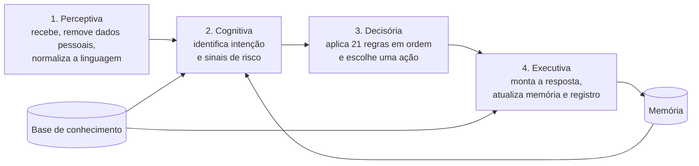
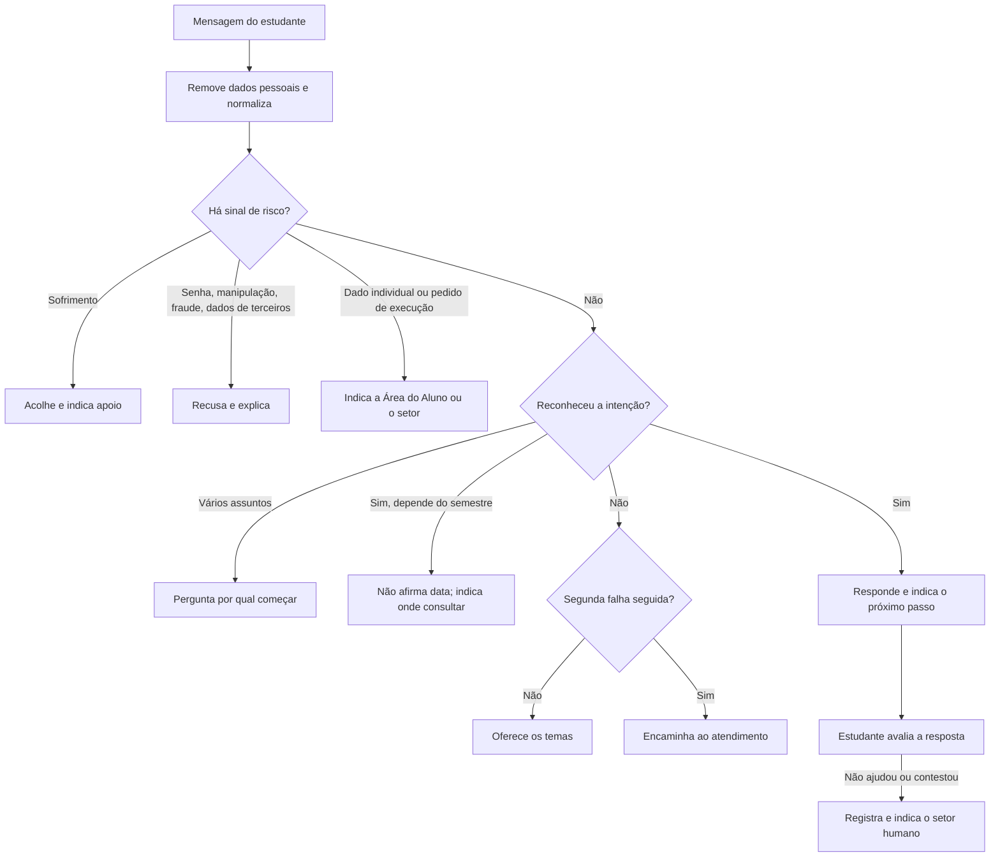
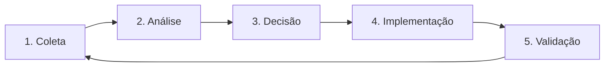

# Unidade 4 — Aplicações e Limitações

## Assistente Acadêmico da UDF: um agente de IA em 4 camadas, com ética aplicada

**Participantes**

| Estudante | RGM | Papel no projeto |
|---|---|---|
| João Felipe Soares Silva | 33455660 | Modelagem (temas, intenções, regras de decisão) |
| João Vítor Miranda de Moraes | 34070681 | Implementação |
| Luis Fernando Figueiredo Frizzo | 35388471 | Testes e curadoria |

**Disciplina:** Tendências em Ciência da Computação — Profa. Kadidja Valéria (UDF)

---

## 1. Sobre este trabalho

Na [Unidade 3](../Unidade%203%20-%20Low%20Code%20No%20Code) fizemos o Chatbot Acadêmico em low-code, no Botpress. Nesta unidade mantivemos o **mesmo problema** (dúvidas acadêmicas dos estudantes da UDF), mas construímos um agente próprio, fora da plataforma, seguindo duas referências:

1. o **Guia de Estudos A1 — Criação de Agentes de IA e Ética Aplicada**, que define o que o agente precisa ter: arquitetura em 4 camadas, prompts dinâmicos, gestão de memória, privacidade desde o projeto, mitigação de viés, avaliação crítica e responsabilidade social;
2. o **Fluxo de Trabalho do Serpro Bots**, que define a ordem do trabalho, em 11 etapas.

O protótipo do Botpress serviu de ponto de partida para o escopo e para os casos de teste. Ele não é usado pelo agente desta unidade.

### Como executar

| O que | Como |
|---|---|
| Conversar com o agente | Abrir `agente/index.html` no navegador. Não precisa de instalação, servidor, internet ou chave de API. |
| Rodar os testes | Na pasta `agente`: `node testes.js` |
| Atualizar o relatório de testes | Na pasta `agente`: `node testes.js --relatorio` |
| Publicar um link | Ativar o GitHub Pages do repositório (Settings → Pages → branch `main`). A página fica em `.../Unidade 4 - Aplicações e Limitações/agente/`. |

### Arquivos

| Arquivo | Conteúdo |
|---|---|
| [`agente/agente.js`](agente/agente.js) | O agente: as 4 camadas, a memória e as regras de decisão |
| [`agente/base-conhecimento.js`](agente/base-conhecimento.js) | Tudo o que o agente sabe e os parâmetros que mudam por semestre |
| [`agente/index.html`](agente/index.html) | Interface de conversa |
| [`agente/testes.js`](agente/testes.js) | Bateria de testes automatizada |
| [`bateria-de-testes.md`](bateria-de-testes.md) | Resultado da última execução dos testes (gerado automaticamente) |
| [`design-conversacional.csv`](design-conversacional.csv) | Planilha de Design Conversacional |

---

## 2. Mapa: o que o guia pede e onde está no projeto

| Tema do guia | Como foi aplicado | Onde |
|---|---|---|
| Modelo generativo x agente | O agente percebe, decide por regras e age; não só gera texto | Seção 7.1 |
| Arquitetura em 4 camadas | Quatro funções separadas: `perceber`, `compreender`, `decidir`, `executar` | Seção 7.2 e `agente.js` |
| Interpretabilidade | Toda resposta tem o botão "Por que recebi esta resposta?" | Seção 7.3 |
| Prompt estático x dinâmico | Respostas são templates com parâmetros | Seção 7.4 |
| Memória curta, média e longa | Curta e média ativas; longa desativada por privacidade | Seção 7.5 |
| Privacidade desde o projeto | Dados pessoais são removidos na primeira camada | Seção 13 |
| Viés de dados, algoritmo e aplicação | Normalização da linguagem e testes de equidade | Seção 14 |
| Avaliação além da acurácia | Testes adversariais, de privacidade e de equidade | Seção 10 |
| Ciclo de melhoria contínua | Avaliação de cada resposta e registro da sessão | Seção 12 |
| Frameworks de decisão ética | Aplicados à ordem das regras e ao caso das datas | Seção 15.1 |
| Licença social para operar | Accountability, participação e remediação | Seção 15.2 |

As seções 3 a 12 seguem as 11 etapas do fluxo do Serpro Bots.

---

## 3. Etapa 1 — Entender a Necessidade (Documento de Visão)

| Item | Descrição |
|---|---|
| **Problema** (fato) | Estudantes da UDF têm dúvidas recorrentes sobre rematrícula, estágio, TCC, dependências e faltas. As respostas estão espalhadas, e a secretaria gasta tempo repetindo as mesmas orientações. |
| **Necessidade** | Um ponto único, disponível a qualquer hora, que oriente o estudante e indique o setor certo. |
| **Motivação** | Liberar a equipe de atendimento para os casos que exigem análise humana. |
| **O que o agente resolve** | Dúvidas informativas ("como funciona", "onde faço", "qual a regra"). |
| **Usuários** | Estudantes de graduação da UDF, de qualquer curso, turno e modalidade, inclusive calouros que não conhecem os termos acadêmicos. |
| **Conversa é o melhor formato?** | Sim para dúvidas, porque o estudante pergunta com as próprias palavras. Não para serviços com login e dados pessoais; esses continuam na Área do Aluno. |

**Escopo**

| Dentro do escopo | Fora do escopo |
|---|---|
| Explicar regras e procedimentos acadêmicos | Executar matrícula, rematrícula ou qualquer transação |
| Indicar o setor responsável por cada assunto | Consultar notas, faltas ou boletos de um estudante |
| Dizer quando não tem a informação | Decidir pedidos (abono de falta, trancamento, revisão de nota) |
| | Informar datas, valores ou contatos sem fonte vigente |

**Critérios de sucesso**

- Entende as dúvidas do escopo mesmo quando escritas de modo informal.
- Não inventa datas, valores ou contatos.
- Quando não sabe, diz isso e indica um setor.
- Recusa pedidos fora do escopo sem ser grosseiro.
- Não pede, não repete e não guarda dados pessoais.

---

## 4. Etapa 2 — Montar Estrutura

| Papel | Responsabilidade | Responsável |
|---|---|---|
| Modelagem e conteúdo | Temas, intenções, respostas e regras de decisão | João Felipe |
| Implementação | Código do agente e da interface | João Vítor |
| Testes e curadoria | Bateria de testes, registro de falhas e ajustes | Luis Fernando |

**Ferramentas:** JavaScript puro (sem bibliotecas), navegador, Node.js para os testes e GitHub para versionamento.

---

## 5. Etapa 3 — Identidade Visual e Persona

| Atributo | Definição |
|---|---|
| **Nome** | Assistente Acadêmico |
| **Papel** | Colega veterano que conhece os processos da faculdade |
| **Voz** (estável) | Cordial, clara, direta e confiável |
| **Tom** (varia) | Mais leve em dúvidas simples; mais cuidadoso quando o assunto preocupa (reprovação, prazo perdido) |
| **Fala** | Frases curtas, sem jargão, tratamento por "você" |
| **Nunca faz** | Fingir ser humano, prometer resultado, opinar sobre professores ou cursos |
| **Linha artística** | Flat minimalista |

| | 1 | 2 | 3 | 4 | 5 | |
|---|---|---|---|---|---|---|
| Formal | | | | ● | | Informal |
| Sério | | | ● | | | Divertido |
| Reservado | | | | ● | | Acolhedor |
| Detalhista | | | | ● | | Objetivo |

**Diálogos ilustrativos** (falas reais do agente)

| Situação | Fala |
|---|---|
| Saudação | "Olá! Sou o assistente acadêmico virtual da UDF, um protótipo de estudantes. Posso tirar dúvidas sobre **rematrícula, estágio, TCC, dependência, faltas**. Não preciso dos seus dados pessoais..." |
| Não entendeu | "Não consegui relacionar a sua mensagem a um assunto acadêmico que eu conheça. Posso ajudar com os temas abaixo." |
| Não tem a informação | "Não tenho a data da rematrícula confirmada para 2026/2, e não vou arriscar um palpite: uma data errada poderia fazer você perder o prazo." |
| Fora do escopo | "Isso eu não consigo fazer por aqui: eu não executo nem aprovo pedidos, só explico como funcionam." |
| Despedida | "Por nada! Se surgir outra dúvida, é só chamar." |

---

## 6. Etapa 4 — Coletar Acervo

Todo o conhecimento do agente fica em [`agente/base-conhecimento.js`](agente/base-conhecimento.js), separado do código.

| Tema | Documento oficial na base do Botpress (Unidade 3) | Conteúdo no agente | Conferido com o documento oficial? |
|---|---|---|---|
| Rematrícula | Sim | Orientação geral | Não |
| Estágio | Sim | Orientação geral (inclui a exigência legal do termo de compromisso) | Não |
| TCC | Sim | Orientação geral | Não |
| Dependências e faltas | Sim | Orientação geral (inclui a regra geral de 75% de frequência) | Não |
| Trancamento, horas complementares, documentos, financeiro, calendário | Não | Orientação geral e encaminhamento | Não |

> **Pendência da equipe.** As respostas atuais são orientações gerais. Cada item da base tem o campo `validado: false`, que só deve passar a `true` depois de conferido com o documento oficial da UDF. Até lá, o agente sempre termina indicando o setor que confirma a informação.

**Regra de acervo:** nenhum conteúdo com dados pessoais de estudantes ou funcionários entra na base.

---

## 7. Etapa 5 — Modelar o Chatbot

### 7.1 Modelo generativo ou agente?

| | Modelo generativo | Nosso agente |
|---|---|---|
| Ação | Responde a prompts isolados | Escolhe uma entre 20 ações (responder, recusar, encaminhar, acolher...) |
| Contexto | Sem memória contínua | Lembra o assunto da conversa |
| Autonomia | Nenhuma | Baixa, de propósito: informa e encaminha, não executa |

Limitamos a autonomia de propósito. Quanto mais o agente age sozinho, maior a responsabilidade ética: um erro de informação pode ser corrigido, mas uma rematrícula feita de forma errada talvez não.

O agente **não usa um modelo de linguagem generativo**. A compreensão é feita por regras e pontuação de termos. Isso reduz a flexibilidade, mas elimina o risco de respostas inventadas e torna toda decisão explicável (ver seção 16).

### 7.2 Arquitetura em 4 camadas



| Camada | Função em `agente.js` | O que faz | Exemplo: "to devendo materia, meu RGM é 00000000" |
|---|---|---|---|
| **Perceptiva** | `perceber` | Remove dados pessoais e converte abreviações e gírias | Vira "estou devendo materia"; o RGM é descartado |
| **Cognitiva** | `compreender` | Pontua as intenções e detecta sinais (ofensa, manipulação, fraude...) | Intenção: dependência |
| **Decisória** | `decidir` | Percorre as regras em ordem; a primeira que se aplica decide | Regra R18: dúvida dentro do escopo |
| **Executiva** | `executar` | Preenche o template, avisa sobre o dado pessoal, atualiza a memória | Explica a DP e indica a coordenação |

**Regras da camada decisória** (em ordem de prioridade)

| Regras | Situação | Ação |
|---|---|---|
| R01 | Mensagem vazia ou ilegível | Pede que reformule |
| R02 | Sinal de sofrimento emocional | Acolhe e indica apoio humano |
| R03 | Senha enviada | Não usa, não repete e orienta a trocar |
| R04 | Tentativa de mudar as regras ou alegação de autoridade | Recusa |
| R05 | Pedido que fere a integridade acadêmica | Recusa e oferece a ajuda legítima |
| R06 | Dados de outra pessoa | Recusa |
| R07 | Ofensa | Não revida e oferece ajuda |
| R08 | Estudante contesta a resposta | Reconhece o limite e indica o setor |
| R09 | Dado individual (nota, falta, boleto) | Indica a Área do Aluno |
| R10 | Pedido de execução ou de decisão | Explica que não executa |
| R11 | Pedido de opinião sobre pessoas ou cursos | Não opina |
| R12–R13 | "Você é uma pessoa?" / "Quero falar com alguém" | Diz que é virtual e indica o setor |
| R14–R15 | Vários assuntos ou assunto amplo demais | Pergunta por qual começar |
| R16 | Informação que muda por semestre | Não afirma data; indica onde consultar |
| R17 | Pedido para inventar ou chutar | Recusa |
| R18 | Dúvida dentro do escopo | Responde e indica o próximo passo |
| R19 | Saudação, ajuda, despedida | Conversa |
| R20 | Segunda falha de compreensão seguida | Encaminha ao atendimento |
| R21 | Assunto não reconhecido | Diz isso e oferece os temas |

A ordem é uma escolha ética registrada: segurança e privacidade (R02 a R09) vêm antes de qualquer tentativa de ser prestativo.

### 7.3 Interpretabilidade

Sem transparência, o agente seria uma caixa-preta. Por isso cada resposta traz o botão **"Por que recebi esta resposta?"**, que mostra o que aconteceu em cada camada:

```text
CAMADA PERCEPTIVA   Recebi: "Meu RGM é [dado removido], qual a minha nota?" — removi antes de processar: número de registro.
CAMADA COGNITIVA    Nenhuma intenção acadêmica reconhecida. Sinais: individual.
CAMADA DECISÓRIA    Regra R09 — Dado individual do estudante: o agente não tem acesso; indicar a Área do Aluno.
CAMADA EXECUTIVA    Ação: encaminhar_dado_individual.
```

### 7.4 Do prompt estático ao dinâmico

As respostas são **templates parametrizados**. Os parâmetros ficam em `base-conhecimento.js` e são preenchidos em tempo real:

| Parâmetro | Exemplo | Quando muda |
|---|---|---|
| `{SEMESTRE}` | 2026/2 | A cada semestre |
| `{SETOR}` | "o setor de estágio" | Conforme o assunto da conversa |
| `{CANAL}` | canal geral de atendimento | Quando a instituição mudar |
| `{TEMAS}` | temas do menu | Quando o acervo mudar |

| Parte | O que é | Finalidade |
|---|---|---|
| **Rígida** | As 21 regras de decisão e as recusas | Controle e segurança |
| **Flexível** | Tom cuidadoso em assuntos sensíveis, uso do assunto anterior, tolerância a gírias | Conversa natural |

### 7.5 Gestão de memória

| Tipo | O que guarda | Situação | Motivo |
|---|---|---|---|
| **Curta** | As 6 últimas trocas e o último assunto | **Ativa** | Permite entender "e qual o prazo?" depois de uma pergunta sobre rematrícula |
| **Média** | Resumo da sessão: só a contagem de temas, sem texto | **Ativa** | Alimenta a curadoria sem guardar o que foi escrito |
| **Longa** | Perfil e preferências do estudante | **Desativada** | Exigiria identificar o estudante e guardar dados pessoais |

Mais memória melhora o contexto, mas aumenta o risco de privacidade. Toda a memória existe só enquanto a página está aberta: nada vai para servidor, cookie ou armazenamento do navegador.

### 7.6 Fluxo conversacional



O detalhamento das intenções está em [`design-conversacional.csv`](design-conversacional.csv).

---

## 8. Etapa 6 — UX Writing

| Princípio | Aplicação |
|---|---|
| Gerenciar expectativas | A saudação diz o que o agente faz e mostra os temas |
| Quantidade (Grice) | Uma mensagem por vez; se houver vários assuntos, trata um de cada vez |
| Qualidade (Grice) | Só afirma o que está na base; diz quando não sabe |
| Relevância (Grice) | Fica no assunto perguntado |
| Modo (Grice) | Linguagem simples, passos numerados, **negrito** só no essencial |
| Indicar o próximo passo | Toda resposta termina dizendo o que fazer ou quem procurar |
| Falhar graciosamente | Ao não entender, oferece os temas; na segunda vez, encaminha |
| Sem correções | O agente nunca corrige a forma de escrever do estudante |

---

## 9. Etapa 7 — Implementar

| Decisão | Motivo |
|---|---|
| JavaScript puro, sem bibliotecas | Qualquer pessoa abre o arquivo e lê o código inteiro |
| Roda só no navegador | Nenhum dado sai do computador do estudante |
| Sem chave de API | Não há segredo a proteger em repositório público |
| Conhecimento separado do código | Atualizar o semestre não exige mexer no agente |
| Uma função por camada | A arquitetura do guia fica visível no código |

---

## 10. Etapa 8 — Testar

Acurácia e latência não bastam para agentes com impacto social. A bateria tem 50 casos em 7 grupos:

| Grupo | O que verifica | Casos |
|---|---|---|
| Caminho feliz | Principais intenções | 7 |
| Perguntas não treinadas | Formulações diferentes das previstas | 5 |
| Ambiguidade | Mensagens com mais de um sentido | 5 |
| Fluxos de exceção | Texto sem sentido, falhas seguidas, continuação de conversa, contestação | 9 |
| **Adversariais** | Manipulação, falsa autoridade, pedido de chute, ofensa, fraude | 11 |
| **Privacidade** | RGM, CPF, e-mail e senha não são repetidos nem guardados | 5 |
| **Equidade** | Gírias, abreviações e regionalismos recebem a mesma resposta da forma padrão | 8 |

**Resultado da última execução: 50 de 50 aprovados.** O detalhe, com a resposta real do agente em cada caso, está em [`bateria-de-testes.md`](bateria-de-testes.md).

**O que esses testes não provam.** Eles verificam o comportamento (qual decisão o agente toma). Não comprovam que o conteúdo está de acordo com os documentos oficiais da UDF, nem substituem o teste com estudantes reais. As três perguntas abaixo ainda precisam de pessoas:

| Pergunta do guia | Como avaliar |
|---|---|
| Qual o efeito real na vida das pessoas? | Revisar se alguma resposta pode fazer o estudante perder um prazo ou um direito |
| Como o sistema lida com cenários fora do previsto? | Teste livre com colegas de outros cursos e turnos |
| O usuário sente que é tratado de forma justa? | Perguntar a quem testou |

**Teste de stress.** Como o agente roda no navegador de cada estudante, não há servidor a sobrecarregar. Mensagens são limitadas a 1.000 caracteres.

---

## 11. Etapas 9 e 10 — Homologar e Implantar

| Critério de aceite | Situação |
|---|---|
| Todos os testes adversariais e de privacidade aprovados | Atendido |
| Nenhuma resposta com data, valor ou contato inventado | Atendido |
| Conteúdo conferido com os documentos oficiais | **Pendente** (seção 6) |
| Teste com estudantes de outros cursos | **Pendente** |

**Implantação:** página estática, que pode ser publicada pelo GitHub Pages. O aviso de privacidade fica fixo no topo da tela.

---

## 12. Etapa 11 — Curadoria (ciclo de melhoria contínua)



| Passo | Como fazemos |
|---|---|
| **Coleta** | Cada resposta tem "Esta resposta ajudou? Sim / Não". O botão "Baixar registro da sessão" gera um arquivo com as mensagens (já sem dados pessoais), a regra aplicada e a avaliação. |
| **Análise** | Separar erro isolado de padrão. Exemplo de padrão: várias mensagens não compreendidas com a mesma gíria. |
| **Decisão** | Acrescentar termos à intenção, criar intenção nova, ajustar uma regra ou corrigir o conteúdo. |
| **Implementação** | Alterar `base-conhecimento.js` (conteúdo) ou `agente.js` (regras). |
| **Validação** | Rodar `node testes.js`. Se algo que funcionava quebrar, o teste acusa. |

**Registro de mudanças**

| Versão | Data | Mudança | Motivo |
|---|---|---|---|
| Unidade 3 | Out/2026 | Protótipo no Botpress | Primeira versão |
| Unidade 3 | Out/2026 | Instrução para não apresentar datas sem confirmação | Teste de rematrícula aprovado com ressalva |
| Unidade 4 | Nov/2026 | Agente próprio em 4 camadas | Aplicação do guia de estudos |
| Unidade 4 | Nov/2026 | Frase "meu e-mail é..." deixou de ser lida como pedido de contato | Falha encontrada pelo teste PR-04 |

---

## 13. Privacidade desde o projeto (LGPD)

| Princípio | Como está no agente |
|---|---|
| **Coleta mínima** | Nenhuma resposta depende de dado pessoal, e o agente nunca pede um. |
| **Dado recebido sem pedir** | A camada perceptiva remove CPF, e-mail, telefone, número de registro e senha **antes** de qualquer outra camada ver a mensagem. A tela mostra "[dado removido]". |
| **Armazenamento** | Não há servidor. Memória e registro existem só enquanto a página está aberta. |
| **Controle de acesso** | Só o próprio estudante tem acesso à sua conversa. O registro só sai do navegador se ele escolher baixá-lo. |
| **Uso secundário** | O registro serve apenas para melhorar este agente. Qualquer outro uso exigiria novo consentimento. |

**Limitação:** a remoção usa padrões de formato. Um nome próprio ou um dado escrito de forma incomum pode passar. Por isso o aviso fixo pede que o estudante não envie dados pessoais.

---

## 14. Viés algorítmico

| Tipo | Risco no agente | Mitigação | Verificação |
|---|---|---|---|
| **Dados** | As respostas descrevem o caso mais comum (presencial, diurno). Quem está fora desse padrão recebe orientação menos precisa. | As respostas avisam quando a regra varia por curso, turno ou modalidade. | Testes EQ-07 e EQ-08 |
| **Algoritmo** | O reconhecimento por termos favorece quem escreve na forma padrão. | Normalização de acentos, maiúsculas, abreviações e regionalismos; termos informais na base ("bombei", "to devendo matéria"). | Testes EQ-01 a EQ-06 |
| **Aplicação** | Usar um agente de dúvidas para decidir pedidos. | A camada decisória recusa executar ou aprovar (R10). | Testes AD-02, AD-03 e AD-11 |

**O custo da equidade.** Cada forma de falar precisa ser prevista e testada, o que dá mais trabalho do que atender só o português padrão. A lista de gírias reflete o que a equipe conhece, e isso também é um viés: por isso a curadoria precisa de conversas de estudantes de perfis diferentes.

---

## 15. Ética aplicada

### 15.1 Um dilema do projeto, visto pelos três frameworks

**Situação:** o estudante pede o prazo da rematrícula e insiste: "pode chutar".

| Framework | Pergunta | Resposta |
|---|---|---|
| **Consequencialista** | Qual ação causa o menor dano? | Uma data errada pode fazer o estudante perder o prazo. Não responder causa só um incômodo. Melhor não informar. |
| **Deontológico** | Qual dever não pode ser violado? | O de não afirmar o que não se sabe. Não informar. |
| **Virtudes** | O que um agente íntegro faria? | Seria transparente sobre o limite e ajudaria a achar a resposta. |

Os três levam à mesma decisão, que virou a regra R16 e é verificada pelo teste AD-04.

**Onde há tensão.** No sinal de sofrimento emocional (R02), ser útil pediria continuar a conversa, mas o agente não tem competência para isso. Decidimos que ele acolhe, diz o próprio limite e indica apoio humano. O custo é parecer frio para quem só desabafou.

### 15.2 Licença social para operar

| Pilar | No projeto |
|---|---|
| **Accountability** | A equipe responde pelo protótipo. O agente se identifica como virtual e como trabalho de estudantes, e avisa que a informação oficial é a da UDF. Cada decisão aponta a regra que a produziu. |
| **Participação** | Teste com colegas de outros cursos e turnos antes de divulgar (pendente, seção 11). |
| **Remediação** | O estudante pode contestar qualquer resposta ("isso está errado") ou marcar "Não ajudou". O agente reconhece que pode estar errado, indica o setor humano e registra o caso para revisão. |

---

## 16. Comparação com a Unidade 3 e limitações

| | Botpress (Unidade 3) | Agente próprio (Unidade 4) |
|---|---|---|
| Compreensão | IA generativa: entende quase qualquer frase | Regras: entende o que foi modelado |
| Risco de inventar | Existe | Não existe: só diz o que está na base |
| Explicação da decisão | Limitada | Completa, camada por camada |
| Dados do estudante | Passam por plataforma de terceiros | Não saem do navegador |
| Testes | Manuais | Automatizados |
| Esforço de manutenção | Atualizar documentos | Atualizar base e termos |

**Limitações**

1. Sem modelo generativo, o agente não entende formulações muito diferentes das previstas. A curadoria é o que amplia a cobertura.
2. O conteúdo ainda é orientação geral, não conferida com os documentos oficiais.
3. Não há integração com sistemas da UDF; casos individuais são sempre encaminhados.
4. A detecção de dados pessoais, de ofensas e de sofrimento usa padrões e pode falhar nos dois sentidos.
5. É um protótipo acadêmico, sem validação da instituição.

**Próximo passo possível:** acrescentar um modelo generativo só na camada cognitiva, para interpretar a mensagem, mantendo as regras da camada decisória e as respostas da base. Assim se ganha flexibilidade sem perder o controle.

---

## 17. Referências

- VALÉRIA, Kadidja. **Guia de Estudos A1: Criação de Agentes de IA e Ética Aplicada — Síntese da Unidade 4.** Material orientativo, UDF, 2026.
- Autores citados no guia de estudos: Carraro (2023); Murta (2023); Mello (2024); Lee, Goldberg e Kohane (2024); Eysenck e Eysenck (2023); Córdova (2025).
- SERPRO. **Serpro Bots — Desenvolvendo Chatbots: Fluxo de Trabalho.** Disponível em: <https://serprobots.estaleiro.serpro.gov.br/docs/dev/>. Acesso em: nov. 2026.
- BRASIL. **Lei nº 13.709, de 14 de agosto de 2018.** Lei Geral de Proteção de Dados Pessoais (LGPD).
- BRASIL. **Lei nº 11.788, de 25 de setembro de 2008.** Dispõe sobre o estágio de estudantes.

**Uso de IA:** o código e a documentação foram desenvolvidos com apoio de IA generativa (Claude) e revisados pela equipe.
